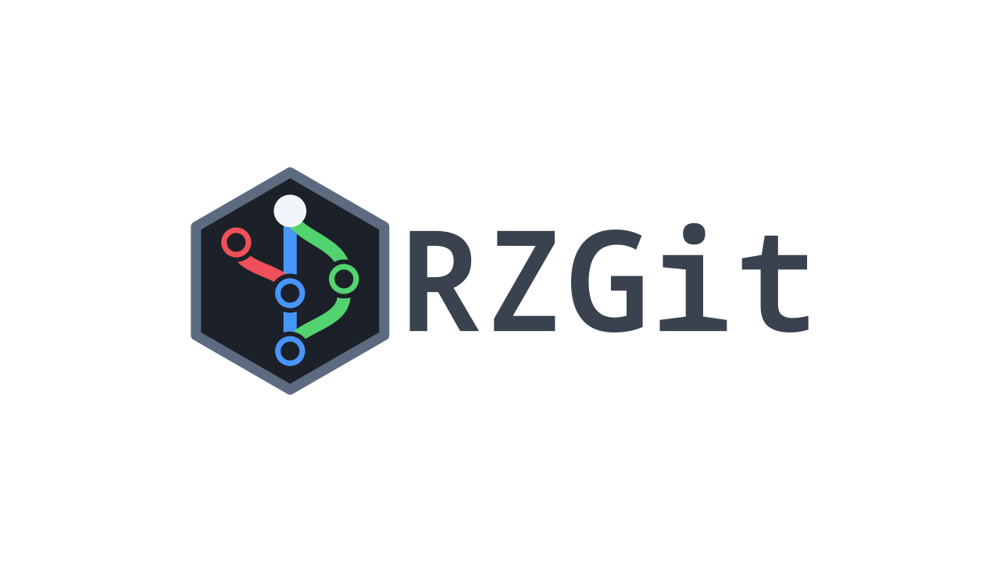

<p align="center">
  <picture>
    <source media="(prefers-color-scheme: dark)" srcset="src/rzgitclient/ui/assets/splash/splash-transparent_dark@2x.png">
    
  </picture>
</p>

# RZGitClient

A Qt (PySide6) git client for Linux. It drives the `git` command-line tool,
so your existing config, credential helpers, SSH keys and hooks just work.

## Setup

PySide6 comes from the system (`dnf install python3-pyside6`). The virtualenv
shares it via `--system-site-packages` and installs this project in editable
mode:

```sh
python3 -m venv --system-site-packages .venv
.venv/bin/pip install -e . --config-settings editable_mode=compat
```

(`editable_mode=compat` keeps Pylance able to resolve the `src/` imports.)

## Running

```sh
.venv/bin/rzgit [path/to/repo]
```

With no path, it reopens the last repository you used.

### App launcher entry

To list RZGitClient in your desktop's launcher and menus, with its icon:

```sh
packaging/linux/install-desktop.sh
```

It installs for your user only, under `~/.local/share`, and the entry starts this
checkout's `.venv/bin/rzgit`. Run it again after moving the checkout or updating the
icons: each run is a clean reinstall. To remove it:

```sh
packaging/linux/install-desktop.sh --uninstall
```

## Tests

```sh
.venv/bin/python -m unittest discover -v -s tests -t .
```

## VS Code

Open `RZGitClient.code-workspace` and install the recommended extensions.

- **F5** launches the app on this repo under the debugger. The Run and Debug
  panel also has a "choose repo…" config and a "current test file" config.
- **Ctrl+Shift+B** runs the app; the default test task runs the suite.
- The Testing panel discovers the unittest suite automatically.

## Layout

- `src/rzgitclient/git/` — git backend (wraps the `git` CLI)
- `src/rzgitclient/ui/` — Qt widgets
- `tests/` — backend tests against throwaway repos
- `.vscode/` — shared editor settings, launch configs and tasks
