# Using RZGit

This guide explains how to use RZGit, a git client for Linux. Each section describes one
part of the app, gives a short summary of how it works, and then says how to use it: the
menu entry, the button, the click or the keyboard shortcut. A table of every keyboard
shortcut is at the end.

RZGit runs the `git` command-line tool for everything it does. Your git configuration,
credential helpers, SSH keys and hooks therefore work exactly as they do in a terminal,
and anything you do in RZGit you could also do with `git` yourself.

The pictures were made in the Light theme. In each one, the part being described is
outlined and the rest of the window is dimmed slightly. Numbered badges mark the things
that the text refers to by number.

**Contents**

1. [Opening repositories and windows](#opening-repositories-and-windows)
2. [The window, its panels and its layout](#the-window-its-panels-and-its-layout)
3. [The Controls panel](#the-controls-panel)
4. [History](#history)
5. [Changes and commits](#changes-and-commits)
6. [Diffs](#diffs)
7. [Commit Details and Commit Files](#commit-details-and-commit-files)
8. [Branches](#branches)
9. [Stashes](#stashes)
10. [Worktrees](#worktrees)
11. [Fetch, Pull and Push](#fetch-pull-and-push)
12. [Settings and themes](#settings-and-themes)
13. [Keyboard shortcuts](#keyboard-shortcuts)

## Opening repositories and windows

RZGit shows one repository per window. You can open as many windows as you like, each on
its own repository or worktree, and they work independently of each other: staging,
committing or switching branches in one window never affects another.

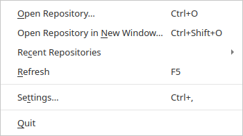

- **File → Open Repository…** (Ctrl+O) asks for a folder and opens it in the current
  window. The same button is the first one in the Controls panel.
- **File → Open Repository in New Window…** (Ctrl+Shift+O) asks for a folder and opens it
  in a new window, which appears beside the current one.
- **File → Recent Repositories** lists the repositories you have opened, with the one you
  used last at the top. Each entry has a submenu with **Open in Current Window**, **Open
  in New Window** and **Remove from List**. When two entries share a folder name, each
  also shows the folder it is in, such as "RZE — ~/dev". A folder that no longer exists is
  marked "(missing)" and can only be removed. **Clear Recent Repositories** empties the
  list.
- **File → Refresh** (F5) reads the repository again. You rarely need it, because each
  window notices changes on disk by itself, including those made by `git` in a terminal.
- **File → Quit** (Ctrl+Q) closes every window. Closing a single window closes only that
  one.

A worktree is never shown in two windows at once. If you open a repository that another
window already shows, RZGit brings that window to the front instead of opening it again.

When RZGit starts, it reopens the repository you used last. You can also name a
repository on the command line, for example `rzgit ~/dev/project`, and it opens that one
instead. The window's title is the repository's name, and the status bar at the bottom
shows its folder, the current branch, the number of commits and the number of changed
files.

## The window, its panels and its layout

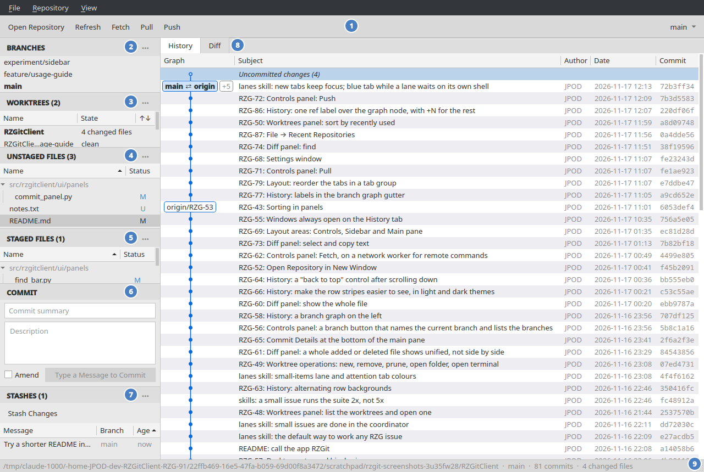

The window is divided into three areas. The **Controls** area runs across the top (1).
The **Sidebar** is on the left and holds the panels for branches and files. The **Main
pane** holds the larger panels. With the Standard layout, the panels are:

| | Panel | What it shows |
|---|---|---|
| 1 | Controls | Buttons for Open Repository, Refresh, Fetch, Pull and Push, and the branch button on the right. |
| 2 | Branches | The local branches. The current branch is in bold. |
| 3 | Worktrees | The repository's worktrees. It only appears once there are at least two. |
| 4 | Unstaged Files | Files with changes that are not staged yet, including new files. |
| 5 | Staged Files | Files with staged changes. It only appears when something is staged. |
| 6 | Commit | The message of the commit you are writing. It only appears when something is staged. |
| 7 | Stashes | The stashes, newest first. |
| 8 | History and Diff | The list of commits, and the changes in the selected file, as two tabs. |
| 9 | The status bar | The folder, the branch, the number of commits and the number of changed files. |

**Commit Details** and **Commit Files** are two more panels, which appear when you select
a commit. They are described in [Commit Details and Commit Files](#commit-details-and-commit-files).

**Panels that appear and disappear.** Several panels collapse when they have nothing to
show, so that the others get the space. Staged Files and Commit appear as soon as
something is staged. Worktrees appears when the repository has a second worktree. When
you select a commit in History, Commit Files takes the place of Unstaged Files, Staged
Files and Commit, and the three come back when you select Uncommitted changes again.

**A panel's menu.** A panel's title bar has a **⋯** button on its right with that panel's
own commands, such as its sort order. When a panel is a tab, right-click the tab to get
the same menu.

**Moving panels.** Drag a panel by its title bar, or by its tab, and drop it onto another
panel. While you drag, a highlighted area shows where the panel will go: beside the
panel under the pointer, above or below it, or into it as a tab. You can also drop a
panel onto an empty Sidebar or Main pane. The Controls panel stays where it is.

**Reordering tabs.** Drag a tab along its tab bar to move it among the other tabs. You
can also right-click a tab and choose **Move Left** or **Move Right**, or press
Ctrl+Shift+PgUp or Ctrl+Shift+PgDown to move the current tab of the tab group you are
working in.

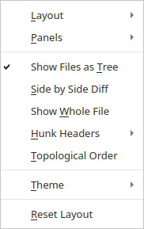

**Layouts.** **View → Layout** switches between three built-in layouts:

- **Standard** puts every panel of the Sidebar in one column on the left.
- **Sidebar Tabs** puts Branches, Worktrees, Unstaged Files and Stashes in tabs on the
  left, above Staged Files and Commit.
- **Stacked** puts the Main pane across the top, with the branches and files side by side
  below it.

**Save Layout As…** saves the current arrangement under a name of your choice, and that
name then appears in the Layout menu. **Manage Layouts…** renames and deletes the layouts
you have saved. **View → Reset Layout** goes back to the Standard layout. The layout
and the window's size are saved when you close the window, and they come back the next
time you start RZGit.

**Hiding panels.** **View → Panels** has an entry for each panel. Uncheck one to hide that
panel, and check it again to bring it back where it was. The Controls panel and the last
visible panel can't be hidden.

**Columns.** Lists with labelled columns let you change them:

- Drag the line between two column labels to resize those two columns. Double-click the
  line to fit the column to its contents.
- Right-click the column labels to show or hide columns, or to choose **Reset Column
  Widths**. The main column of each list is always shown.
- Click a column label to sort the list by that column, and click it again to reverse the
  order. An arrow marks the column the list is sorted by. Not every column sorts.

Your column choices and sort orders are saved for each panel.

**Sorting.** Lists that can be sorted have a **Sort By** submenu in their panel menu. It
offers the panel's orders and, below them, **Reversed**.

## The Controls panel

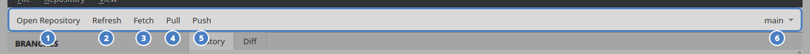

The Controls panel holds the buttons you use most often. **Open Repository** (1) and
**Refresh** (2) work as in the File menu. **Fetch** (3), **Pull** (4) and **Push** (5) are
described in [Fetch, Pull and Push](#fetch-pull-and-push).

The **branch button** (6) on the right shows the current branch. When HEAD is detached, it
shows "detached at" and the commit's short hash instead. Click it to open a list of the
local branches, and choose one to switch to it. When there are more than 15 branches, the
list has a filter box at the top: type part of a branch name to narrow the list, and press
Enter to switch when only one branch is left. **New Branch…** at the bottom of the list
makes a new branch from the current one.

## History

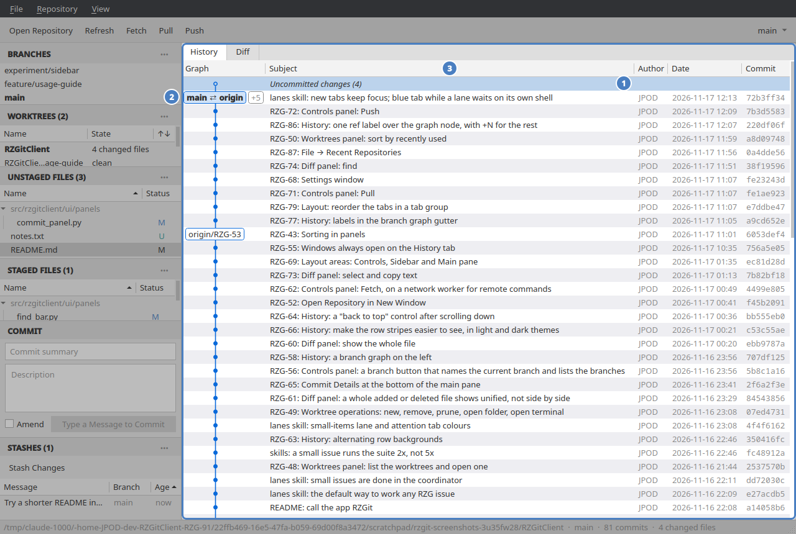

History lists the commits of the current branch, that is every commit reachable from
HEAD, newest first. Its columns are **Graph**, **Subject**, **Author**, **Date** and **Commit**
(the short hash).

- **Uncommitted changes** (1) is always the first row, and it is selected when the window
  opens. It stands for the changes in your working folder, and selecting it shows the
  Unstaged Files, Staged Files and Commit panels. It stays pinned at the top while you
  scroll, so you can always go back to it with one click.
- **The branch graph** in the Graph column draws a dot for each commit and lines that join
  each commit to its parents, in a separate colour for each line of development.
- **Ref labels** (2) sit on the graph and name the branches, remote branches, tags and
  stashes that point at a commit in the list. A stash's label is on the commit it was made
  from. A commit with several of them shows one label and a
  "+N" count for the rest. Hover over the label to see all of them. A local branch and its
  remote branch on the same commit share one label, such as "main ⇄ origin". The current
  branch's label is in bold. To hide the labels, hide the Graph column.
- **Column labels** (3) resize, hide and show columns as described in
  [Columns](#the-window-its-panels-and-its-layout). History always keeps the order of the
  commits, so its labels don't sort.

Select a commit to see its details and its files, as described in
[Commit Details and Commit Files](#commit-details-and-commit-files).

**Order.** History lists commits by date. **View → Topological Order**, which is also in
History's tab menu, never shows a commit before all of its children and keeps each line
of development together, as `git log --topo-order` does.

**Long histories** are read a page at a time as you scroll down, so even a very large
repository opens quickly. The status bar shows the total number of commits.

**Back to top.** When you have scrolled down, a **↑ Back to top** button floats over the
list. If new commits arrive while you are scrolled down, it says how many, for example
"↑ 3 new commits". Click it, or press Ctrl+Home, to go back to the top.

**Dates** follow the *Date format* setting described in
[Settings and themes](#settings-and-themes).

## Changes and commits

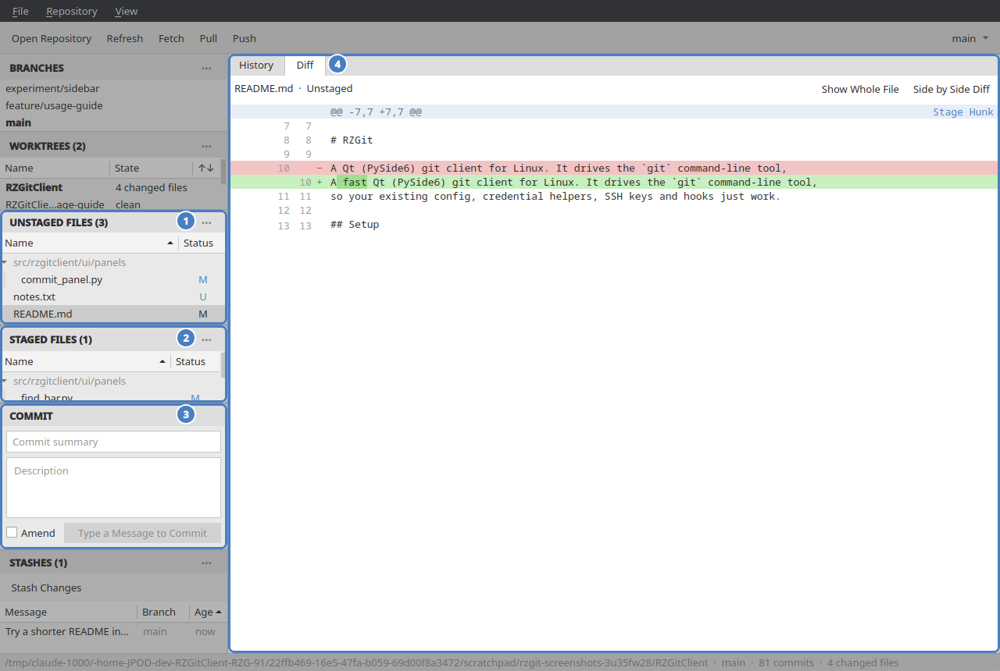

Git keeps your work in three places: the files in your working folder, the *index* of
changes you have staged for the next commit, and the commits themselves. RZGit shows the
first two as two lists and gives you a panel to write the commit.

- **Unstaged Files** (1) lists the files whose changes are not staged yet, including new
  files that git doesn't track.
- **Staged Files** (2) lists the files whose changes are staged.
- **Commit** (3) is where you write the commit message.
- **Diff** (4) shows the changes in the file you select.

A file with both staged and unstaged changes is listed in both panels. Each file shows a
status letter on the right: **M** for modified, **A** for added, **D** for deleted, **R**
for renamed, **C** for copied, **T** for a changed file type, **U** for a file git doesn't
track yet, and **!** for a conflict. Hover over a file to see the full word.

**Files as a tree.** **View → Show Files as Tree**, which is on by default, shows the files
under their folders. A chain of folders that each hold only one folder is shown as one
row, such as `src/rzgitclient/ui`. Click a folder's arrow to fold it, and it stays folded
while RZGit runs. Selecting a folder selects every file under it, so you can stage or
unstage a whole folder at once. Turn the option off to see one full path per row instead.
Each of the three file panels can be sorted by **Name** or **Status**.

**Staging.** Select one or more files with the mouse, using Ctrl and Shift to select
several, and then:

- Double-click them, or press Enter, to move them to the other list: unstaged files are
  staged, and staged files are unstaged.
- Use **Repository → Stage** (Ctrl+S) or **Repository → Unstage** (Ctrl+U).
- Use **Repository → Stage All** (Ctrl+Shift+S) or **Repository → Unstage All**
  (Ctrl+Shift+U) to stage or unstage every change at once.

After you stage files, they stay selected in Staged Files, so you can unstage them again
straight away if you change your mind. You can also stage or unstage single hunks or lines
from the Diff panel, as described in [Diffs](#diffs).

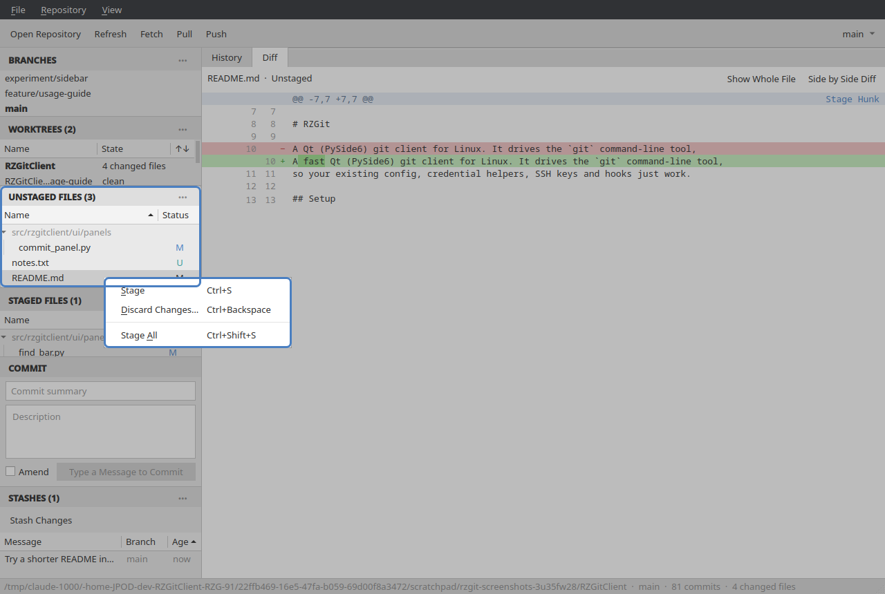

Right-click a file to get the same commands. Unstaged Files offers **Stage**, **Discard
Changes…** and **Stage All**, and Staged Files offers **Unstage** and **Unstage All**.

**Discarding.** **Repository → Discard Changes…** (Ctrl+Backspace) throws away the unstaged
changes of the selected files. It lists the files and asks you to confirm first, because
this can't be undone. Staged changes are kept, and new files that git doesn't track are
moved to the trash rather than deleted.

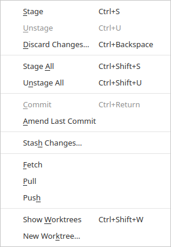

**Committing.** Type a one-line summary in the Commit panel's first field and, if you
like, a longer description in the field below it. Pressing Enter in the summary moves to
the description. The counter inside the summary field shows its length, and it changes
colour past 72 characters, which is longer than most tools show in one line. Then click
the button at the bottom, press Ctrl+Enter, or use **Repository → Commit**. The button
says what is still needed: "Stage Files to Commit", "Type a Message to Commit", or, when
everything is ready, "Commit 3 Files". After a successful commit, both fields are cleared.

**Drafts.** A message you have started is saved as you type, for each repository. It is
still there after you switch to another repository or restart RZGit.

**Amending.** Check **Amend** beside the Commit button, or use **Repository → Amend Last
Commit**, to replace the last commit instead of adding a new one. The fields then show the
last commit's message, which you can edit. The button reads "Amend Last Commit", or, when
something is staged, "Amend with 3 Files", and it adds the staged changes to that commit.
If the last commit has already been pushed, RZGit asks before amending it, because the
remote keeps the old commit and pushing the branch would then need a force push. Uncheck
Amend to get your own draft back.

## Diffs

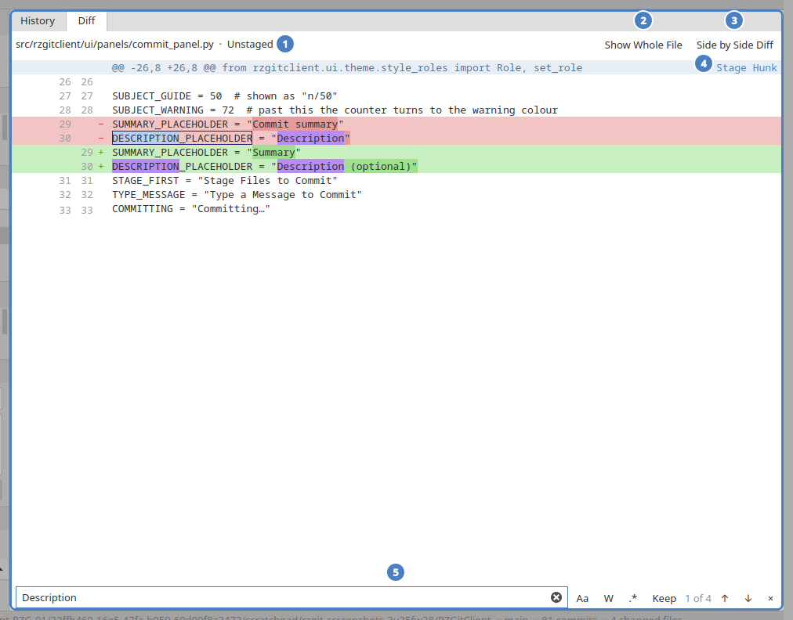

The Diff panel shows the changes in the file you select in any of the file panels. The bar
at the top names the file and says whether you are looking at its unstaged or staged
changes, or at a commit (1). Removed lines are red and marked **−**, added lines are green
and marked **+**, and the words that changed within a line are highlighted more strongly.

**Side by side.** **View → Side by Side Diff**, or the **Side by Side Diff** button (3),
shows the old file on the left and the new file on the right. Uncheck it to see one column
with both line numbers. A file that was added or deleted as a whole always shows in one
column, because one side would be empty.

**Whole file.** **View → Show Whole File**, or the **Show Whole File** button (2), shows
every line of the file with the changes highlighted where they are, instead of only the
changes and a few lines around them. While it is on:

- A **Hunk Headers** button in the bar, also in **View → Hunk Headers**, chooses how each
  group of changes is introduced: **Full** shows git's `@@` lines, **Slim** (the default)
  shows a thin row above each group, and **Off** shows nothing.
- Long stretches of unchanged lines can be folded. Click the **▾** mark beside such a
  stretch to fold it into one "⋯ N unchanged lines" row, and click that row to unfold it.
  Right-click for **Fold All Unchanged** and **Unfold All**. The *Diff* settings say how
  long a stretch must be and whether files open folded.

**Staging hunks and lines.** In a diff of unstaged or staged changes, each group of
changes (a *hunk*) has a **Stage Hunk** or **Unstage Hunk** link on the right of its header
(4). To work with single lines, click a changed line in the line-number area to select
it. Drag to select several lines, Shift-click to extend the selection, or Ctrl-click to
add or remove one line. Each changed line has a small **Stage** or **Unstage** button at
the left edge, which shows while the pointer is over the line and on every selected line.
Clicking it stages or unstages that line, or all the selected lines if it is one of
them. Right-click the diff for **Stage Hunk** and **Stage Selected Lines** (or **Unstage
Hunk** and **Unstage Selected Lines** for staged changes) and, for the unstaged changes of
a tracked file, **Discard Hunk…** and **Discard Selected Lines…**, which ask before they
discard anything. The diff of a commit is read-only.

**Selecting and copying text.** You can select the diff's text like text in an editor:
drag to select, double-click a word, or triple-click a line. Ctrl+A selects all the text
of one side, and Ctrl+C or **Copy** in the right-click menu copies the selected code
without line numbers or **+** and **−** marks. Esc clears the selection.

**Find.** Press Ctrl+F in the Diff panel to open the find bar (5) at its bottom. The search
runs as you type, highlights every match, and shows a count such as "1 of 4".

- Press Enter, F3 or the **↓** button for the next match, and Shift+Enter, Shift+F3 or
  **↑** for the previous one. The search wraps around at the ends.
- The toggles beside the field are **Aa** (match case), **W** (whole words only) and
  **.\*** (a regular expression).
- **Keep** keeps the search open when you select another file, and searches that file.
  Without it, the find bar closes when you change files.
- Press Esc or click **×** to close the find bar.

**Large diffs.** A diff longer than the limit in the *Diff* settings shows "Large diff"
with a **Show Anyway** button, so a huge file doesn't slow the app down by accident. When
the whole file is too large, **Show Changes Only** turns Show Whole File off. Binary files
show "Binary file" instead of a diff.

## Commit Details and Commit Files

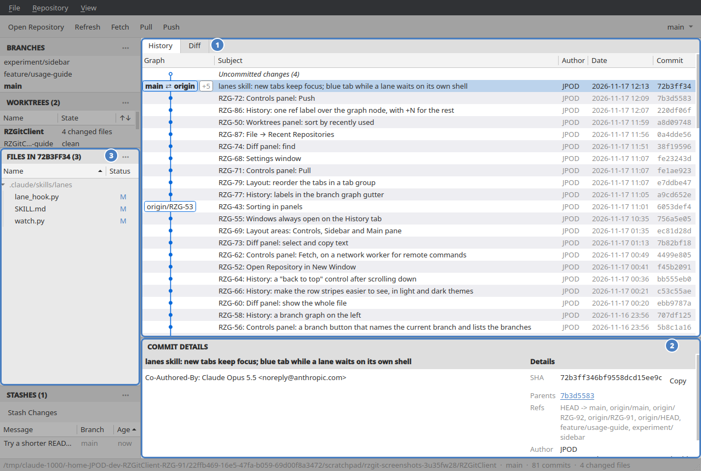

When you select a commit in History (1), two more panels appear.

**Commit Details** (2), at the bottom of the main pane, shows the commit's summary and
message, and a **Details** section with its **SHA**, **Parents**, **Refs**, **Author** and,
when it differs, **Committer**. The **Copy** button beside the SHA copies the full hash.
A parent that is loaded in History is a link: click it to select that commit. You can
select any text with the mouse and copy it with Ctrl+C. Right-click the summary or the
message for **Copy Selection**, **Copy Message (Git Format)**, which copies the message
with git's own line breaks, and **Select All**. Right-click a parent for **Copy SHA**.
In a wide window, the message and the details sit side by side.

**Commit Files** (3) lists the files the commit changed, in the same way as Unstaged
Files. Select a file to see its changes in the Diff panel.

Select **Uncommitted changes** at the top of History to go back to your own work.

## Branches

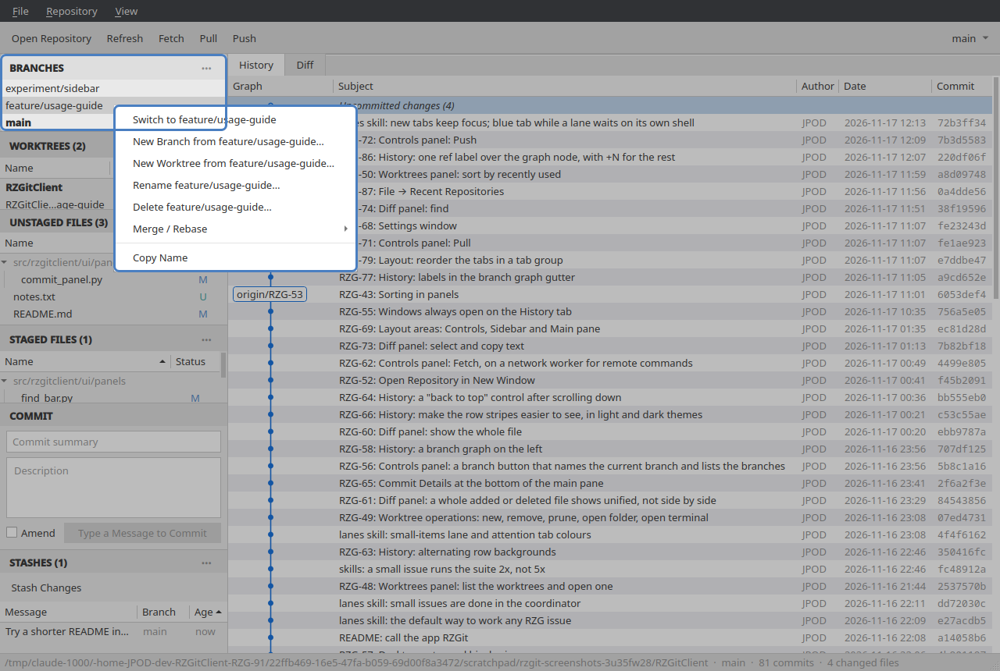

The Branches panel lists the local branches, with the current one in bold. **Sort By** in
its panel menu offers **Name** and **Last Commit**.

- Double-click a branch to switch to it.
- Right-click a branch for its menu: **Switch to** the branch, **New Branch from** it,
  **New Worktree from** it, **Rename** it, **Delete** it, and the **Merge / Rebase**
  submenu, which can merge the branch into the current one or rebase the current branch
  onto it. **Copy Name** copies the branch's name. Commands that can't apply to the
  current branch are disabled and say "(current branch)".

RZGit asks before each of these commands, and the button that confirms names the command.

- **Switching** with uncommitted changes offers **Stash and Switch**, which puts your
  changes in a stash first, or **Bring Changes**, which lets git carry them over to the
  other branch if it can. A stash made this way stays in the Stashes panel for you to apply
  later.
- **New Branch…** asks for a name, and **Switch to it**, which is checked, switches to
  the new branch straight away.
- **Delete…** asks again with **Delete Anyway** if the branch has commits that aren't merged
  into the current branch, because those commits would be lost.
- **Merge** and **Rebase** stop and change nothing if git reports a conflict. Rebase also
  warns that it rewrites the commits of the current branch.

You can also switch branches and make new ones with the branch button in the Controls
panel, as described in [The Controls panel](#the-controls-panel).

## Stashes

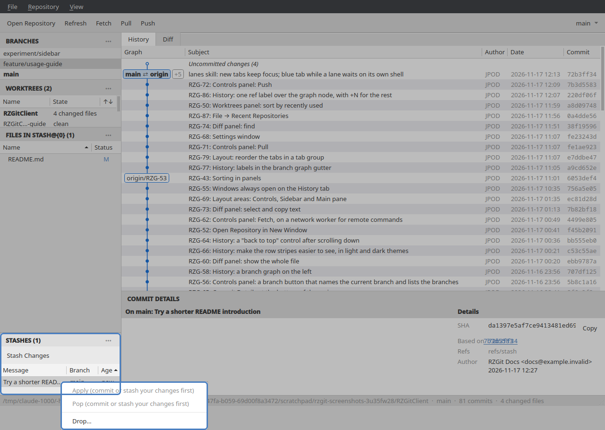

A stash puts your uncommitted changes aside so that you can work on something else and
bring them back later. The Stashes panel lists them, newest first, with their message,
the branch they were made on, and their age. **Sort By** offers **Age**, **Message** and
**Branch**.

- **Stash Changes…**, the button above the list and also in the Repository menu, asks for
  an optional message and whether to **Include untracked files**, then stashes all your
  changes.
- Select a stash to see its files in Commit Files, its details in Commit Details, and its
  changes in the Diff panel. Its label also appears in History on the commit it was made
  from.
- Right-click a stash for **Apply**, which brings its changes back and keeps the stash,
  **Pop**, which brings them back and removes the stash, and **Drop…**, which deletes the
  stash after asking. Apply and Pop need a working folder without changes, and they are
  disabled until you have committed or stashed your current changes.

## Worktrees

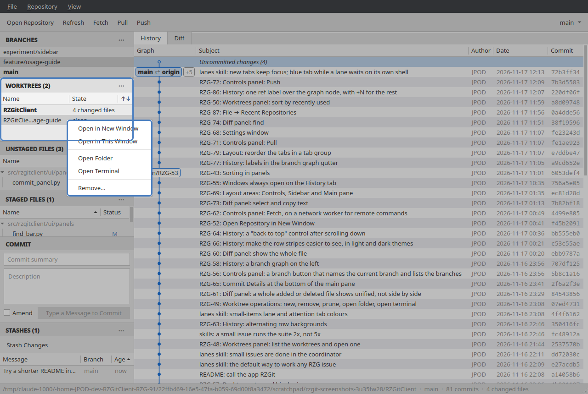

A worktree is a second working folder of the same repository, with a different branch
checked out, so that you can work on two branches at once. The Worktrees panel lists them,
with the main worktree first. It appears once the repository has more than one worktree,
and **Repository → Show Worktrees** (Ctrl+Shift+W) brings it to the front.

For each worktree, the panel shows its **Name**, its **State** (such as "clean" or "3
changed files"), and **↑↓**, how many commits its branch is ahead of and behind its
upstream. The **Branch** and **Path** columns are hidden at first; right-click the column
labels to show them. The worktree this window shows is in bold. **Sort By** offers **Git
Order**, **Recently Used** (the default), **Name**, **Branch** and **Path**.

- Double-click a worktree, or select it and press Enter, to open it in a window of its
  own.
- Right-click a worktree for **Open in New Window**, **Open in This Window**, **Open
  Folder**, which opens it in your file manager, **Open Terminal**, and **Remove…**.
- The panel menu has **Open**, **New Worktree…**, **Prune Missing Worktrees…**, which
  cleans up the records of worktrees whose folders are gone, and **Refresh**.

**New Worktree…**, also in the Repository menu and in a branch's right-click menu, asks
for an **Existing branch** or a **New branch** with its start point, and for the folder,
which it suggests beside the main repository. With **Open it** checked, the new worktree
opens in a window of its own.

**Remove…** deletes the worktree's folder and keeps its branch. If the worktree has
changes, RZGit asks again with **Remove Anyway**, because they would be lost. The main
worktree, a locked worktree, and the worktree of the window you are in can't be removed.

**Open Terminal** starts the terminal named in the *Terminal command* setting. When that
is empty, it uses `$TERMINAL`, and then the first of `konsole`, `gnome-terminal`,
`xfce4-terminal` and `x-terminal-emulator` that is installed.

## Fetch, Pull and Push

These commands talk to your remotes. They are in the Repository menu and in the Controls
panel, and the status bar shows their progress while they run. While one of them runs,
its menu entry and button say so ("Fetching…", "Pulling…" or "Pushing…"), and choosing
it again cancels the command. Only one of them runs at a time.

**Fetch** downloads new commits from every remote without changing your branches.

**Pull** brings the current branch up to date with its upstream branch. When the branch is
behind, the button shows how far, for example **Pull ↓3**. If you have uncommitted
changes, RZGit first asks whether to **Stash and Pull**, which stashes them and puts them
back afterwards, or **Pull with Changes**, which leaves them to git. If your branch and its
upstream have both moved on, it asks whether to **Rebase** or **Merge**. A pull that would
cause a conflict stops and changes nothing.

**Push** sends the current branch to its upstream. When the branch is ahead, the button
shows how far, for example **Push ↑2**. If the branch doesn't have an upstream yet, RZGit
asks before pushing it to a remote and setting it up to track that branch. RZGit never
forces a push. If the remote rejects it, the error is shown and nothing changes.

## Settings and themes

**Themes.** **View → Theme** chooses **Light**, **Dark**, or **System**, which follows your
desktop's setting. **Colour-blind Friendly Colours**, in the same menu, shows added and
removed lines, file statuses and the graph's lines in colours built on blue and orange
instead of green and red, so they stay distinct with the common kinds of colour
blindness. The theme changes at once in every
window.

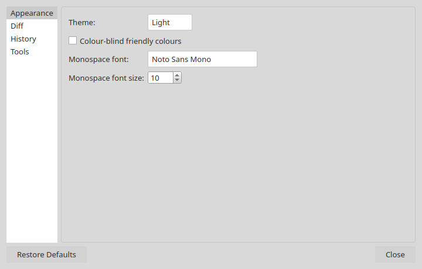

**Settings.** **File → Settings…** (Ctrl+,) opens the Settings window, which has a page
for each group of settings. A change takes effect at once, in every window, and nothing
needs a restart.

- **Appearance:** the theme and colour-blind colours, as in the View menu, and the
  **Monospace font** and **Monospace font size** used by diffs and commit hashes.
- **Diff:** how long a stretch of unchanged lines must be before it can be folded, how
  many lines are kept next to a change, whether stretches are folded when a whole file
  opens, the **Tab width**, and the length above which RZGit asks before showing a diff.
- **History:** the **Date format**, which is either the ISO format with or without
  seconds, or your locale's short format.
- **Tools:** the **Terminal command** that Open Terminal starts.

**Restore Defaults** at the bottom resets either every setting or only the settings of the
page you are looking at.

The View menu's options, such as Side by Side Diff and Show Files as Tree, are not in the
Settings window. They belong to each window while it is open, and they are saved when the
window closes.

## Keyboard shortcuts

Shortcuts that work in "the whole window" work wherever the focus is. The others work
when the focus is in the panel or field named.

| Shortcut | What it does | Where it works |
|---|---|---|
| `Ctrl+O` | Opens a repository in this window. | The whole window |
| `Ctrl+Shift+O` | Opens a repository in a new window. | The whole window |
| `F5` | Reads the repository again. | The whole window |
| `Ctrl+,` | Opens the Settings window. | The whole window |
| `Ctrl+Q` | Closes every window and quits. | The whole window |
| `Ctrl+S` | Stages the selected files. | The whole window |
| `Ctrl+U` | Unstages the selected files. | The whole window |
| `Ctrl+Backspace` | Discards the unstaged changes of the selected files, after asking. | The whole window |
| `Ctrl+Shift+S` | Stages every change. | The whole window |
| `Ctrl+Shift+U` | Unstages every change. | The whole window |
| `Ctrl+Enter` | Commits the staged changes with the Commit panel's message. | The whole window |
| `Ctrl+Shift+W` | Shows the Worktrees panel. | The whole window |
| `Ctrl+Shift+PgUp` | Moves the current tab one place to the left. | A tab group |
| `Ctrl+Shift+PgDown` | Moves the current tab one place to the right. | A tab group |
| `Enter` | Moves the selected files to the other list; opens the selected worktree in a window of its own; moves from the commit summary to the description; goes to the next match; switches to the only branch left in the filter. | Unstaged Files and Staged Files; Worktrees; the Commit panel; the Diff panel's find bar; the branch button's list |
| `Shift+Enter` | Goes to the previous match. | The Diff panel's find bar |
| `Ctrl+F` | Opens the find bar. | The Diff panel |
| `F3` | Goes to the next match. | The Diff panel |
| `Shift+F3` | Goes to the previous match. | The Diff panel |
| `Esc` | Closes the find bar, or clears the selection in the diff. | The Diff panel |
| `Ctrl+A` | Selects all the text of the diff (of one side, side by side), or of a message. | The Diff panel; Commit Details |
| `Ctrl+C` | Copies the selected text. In a diff, it copies only the code. | The Diff panel; Commit Details |
| `Ctrl+Home` | Goes to the top of the list. | History |
